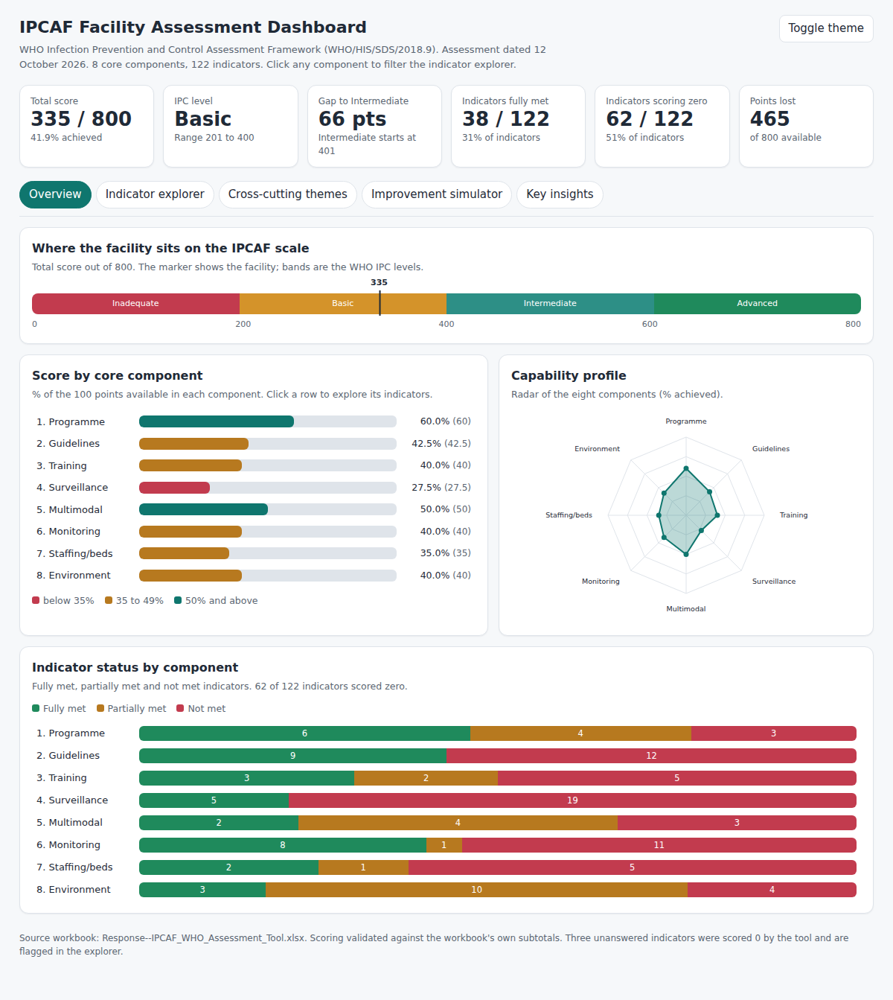
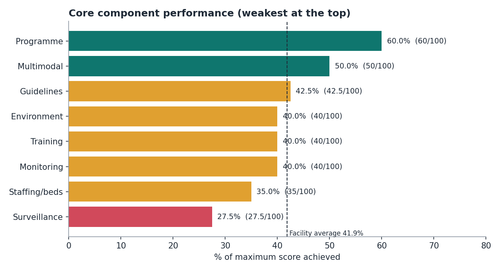
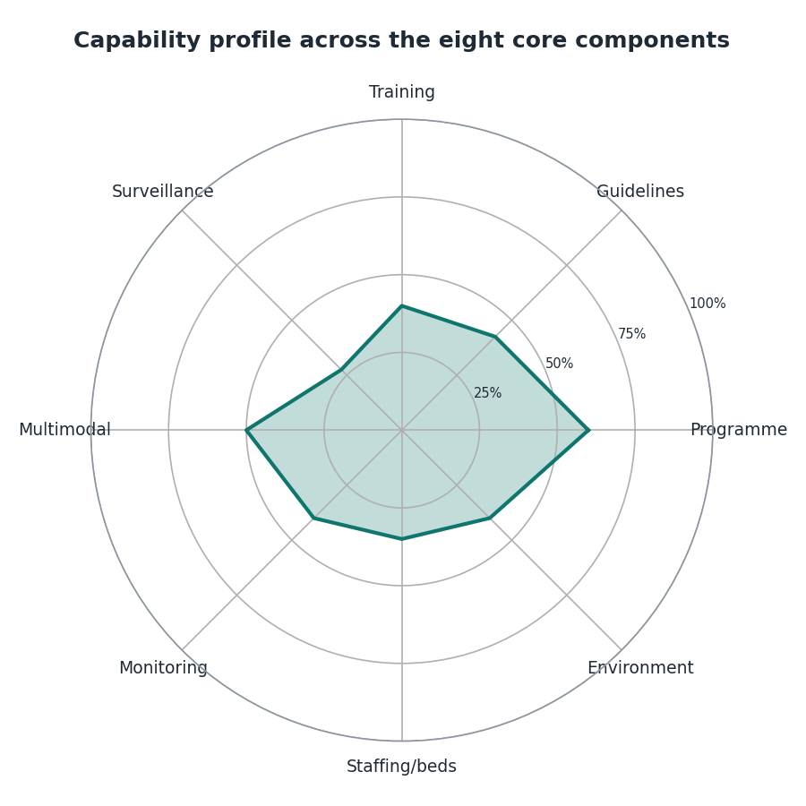
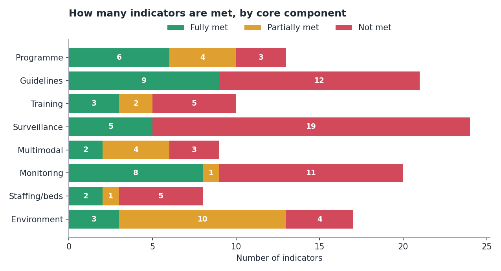
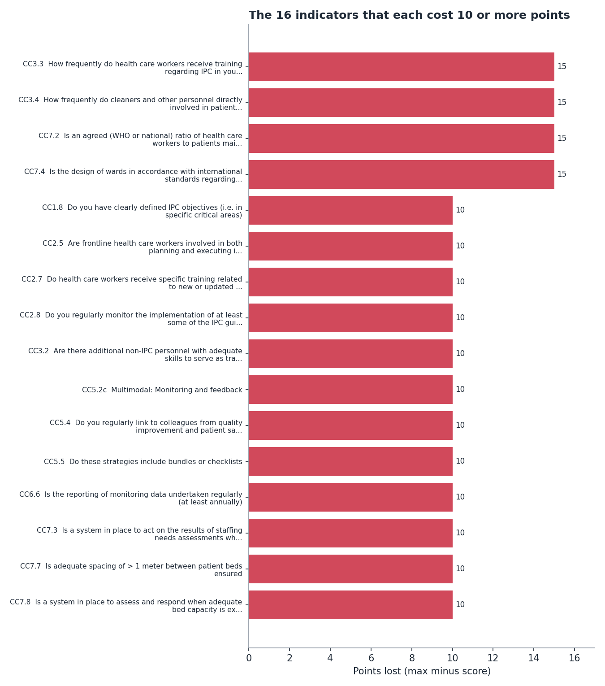
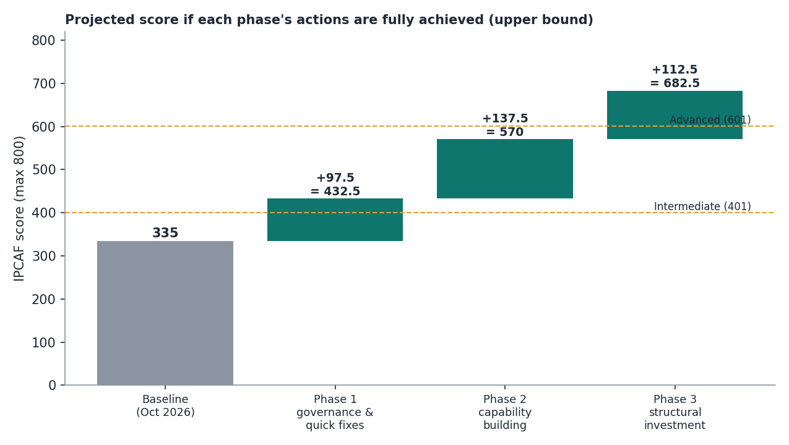
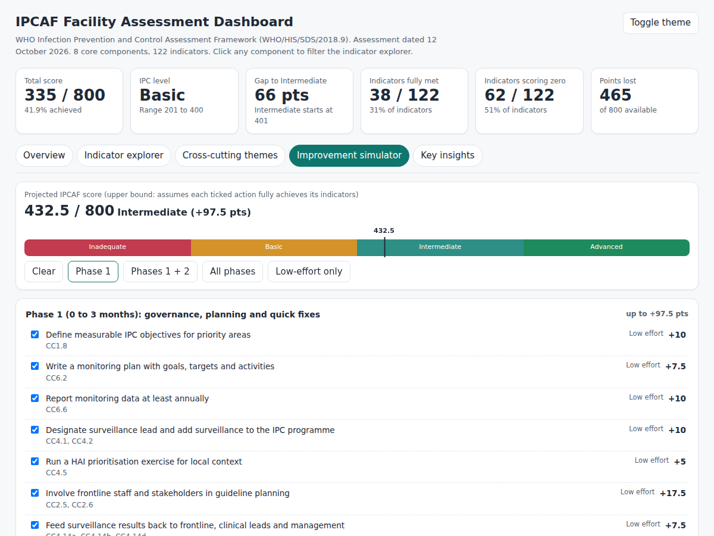

# Infection Prevention and Control Assessment: Analysis, Dashboard and Recommendations

**A data analysis of a facility-level WHO IPCAF assessment (completed 12 October 2026)**

[](https://Favour-Daniel123.github.io/ipcaf-who-assessment-analysis/)

-d4932a)

> **Live dashboard:** after enabling GitHub Pages (see [Publishing](#publishing-on-github)), the interactive dashboard is at
> `https://Favour-Daniel123.github.io/ipcaf-who-assessment-analysis/`. You can also open `docs/index.html` locally in any browser.



---

## Table of contents
1. [Executive summary](#1-executive-summary)
2. [The problem](#2-the-problem)
3. [Data](#3-data)
4. [Tools used](#4-tools-used)
5. [Analysis steps](#5-analysis-steps)
6. [Findings and insights](#6-findings-and-insights)
7. [Recommendations](#7-recommendations)
8. [Limitations and assumptions](#8-limitations-and-assumptions)
9. [The interactive dashboard](#9-the-interactive-dashboard)
10. [Repository structure and reproducing the analysis](#10-repository-structure-and-reproducing-the-analysis)
11. [Publishing on GitHub](#publishing-on-github)

---

## 1. Executive summary

The facility scored **335 out of 800 (41.9%)**, which places it at the **Basic** IPC level (201 to 400). It needs **66 more points** to reach **Intermediate** (401 and above).

| Headline | Value |
|---|---|
| Total score | 335 / 800 (41.9%) |
| Assigned IPC level | Basic |
| Indicators fully met | 38 of 122 (31%) |
| Indicators partially met | 22 of 122 (18%) |
| Indicators scoring zero | 62 of 122 (51%) |
| Points lost | 465, of which 78.5% come from indicators that scored zero |
| Strongest component | IPC programme, 60.0% |
| Weakest component | HAI surveillance, 27.5% |

**The five things to know**

1. **Surveillance is the biggest gap.** 19 of 24 surveillance indicators scored zero. The laboratory can identify pathogens and resistance patterns reliably (full marks), but there is no surveillance lead, no IT support and no surveillance of surgical-site, device-associated or multidrug-resistant infections.
2. **Frontline staff are absent from every improvement loop.** Eight indicators about frontline engagement (training, guideline planning, feedback, link nurses) all scored zero, 0 of 70 points.
3. **Device and procedure-related infections are a blind spot.** There are no guidelines, no audits and no surveillance for them. All 12 related indicators scored zero.
4. **The scores are uneven rather than uniformly low.** The facility has a programme, a committee, a multidisciplinary team, interactive training methods and good laboratory capacity. Most losses come from missing plans, frequency and follow-through, not from missing foundations.
5. **Intermediate level is realistic in the short term.** Phase 1 actions (mostly low-cost governance and process fixes) are worth up to 97.5 points, which would project the score to 432.5. Structural issues such as staffing, ward design and water supply need longer-term investment.

---

## 2. The problem

Health care-associated infections (HAIs) are among the most frequent adverse events in care delivery. The WHO **Infection Prevention and Control Assessment Framework (IPCAF)** gives a facility a structured self-assessment against eight core components of IPC, producing a score out of 800 and one of four levels (Inadequate, Basic, Intermediate, Advanced).

A completed workbook gives a score, but a score alone does not tell leadership:

- **where** the facility is weakest and why,
- **which specific indicators** cost the most points,
- **what patterns** run across components (for example, a missing guideline, plus no audit, plus no surveillance for the same infection),
- **what to do first**, and how far each action could move the score.

**Objective:** turn the completed IPCAF workbook into an evidence-based picture of the facility's IPC capability, an interactive dashboard for exploring it, and a prioritised, quantified improvement plan.

---

## 3. Data

| Item | Detail |
|---|---|
| File | `data/raw/Response--IPCAF_WHO_Assessment_Tool.xlsx` |
| Assessment date | 12 October 2026 |
| Instrument | WHO IPCAF, facility level (WHO/HIS/SDS/2018.9) |
| Structure | A `Summary` sheet, a `Lookups` sheet (answer-to-score tables) and eight core-component sheets `CC1` to `CC8` |
| Records | 122 indicators (13, 21, 10, 24, 9, 20, 8, 17 per component), each with the answer given, score and maximum |
| Scoring | Each component is worth 100 points. Scores are formulas that look the chosen answer up in the `Lookups` sheet |

| Core component | Indicators |
|---|---|
| 1. IPC programme | 13 |
| 2. IPC guidelines | 21 |
| 3. IPC education and training | 10 |
| 4. HAI surveillance | 24 |
| 5. Multimodal strategies | 9 |
| 6. Monitoring/audit of IPC practices and feedback | 20 |
| 7. Workload, staffing and bed occupancy | 8 |
| 8. Built environment, materials and equipment | 17 |

The workbook does not name the facility, its type or its bed count, so no benchmarking against similar facilities is possible from this file alone.

---

## 4. Tools used

| Purpose | Tool |
|---|---|
| Data collection | WHO IPCAF Excel assessment tool (`.xlsx`) |
| Data extraction and validation | Python 3.12, `openpyxl` (reading both formulas and cached values) |
| Wrangling and metrics | `pandas`, `numpy` |
| Static charts for this report | `matplotlib` |
| Interactive dashboard | Hand-written HTML, CSS and vanilla JavaScript with inline SVG charts. No external libraries or network calls, so it works offline and on GitHub Pages |
| Dashboard testing | Playwright (headless Chromium) to confirm filters, simulator and theme switching work with no console errors |
| Version control and hosting | Git, GitHub, GitHub Pages |

---

## 5. Analysis steps

### Step 1. Inspect the workbook
Listed every sheet, read formulas as well as cached values, and confirmed how scores are produced (`INDEX/MATCH` against the `Lookups` sheet, then `SUM` per component, then a nested `IF` for the level).

### Step 2. Extract into a tidy table
Parsed `CC1` to `CC8` into one row per indicator with: component, indicator number, question, answer, score and maximum. Result: **122 rows**.

### Step 3. Validate before analysing
The pipeline stops if any check fails. All 27 checks passed:
- each component's item scores sum to the workbook's own subtotal and to the `Summary` sheet,
- each component's maximum is exactly 100,
- no score exceeds its maximum,
- the total (335) matches and the level (Basic) agrees with the WHO thresholds.

### Step 4. Data quality review
| Finding | Treatment |
|---|---|
| **3 indicators left blank** (CC6 3i waste management audit, CC6 5a audit feedback within IPC team, CC8 2 safe drinking-water station) | The tool scores a blank as 0. Kept as scored, flagged in the data and dashboard. Sensitivity: even if all three were fully met the total would be 350, still Basic |
| **1 reverse-scored indicator** (CC7 6, beds in corridors) | "No" earns the full 15 points. Handled by using the workbook's own score, never by re-deriving it from the answer text |
| **File metadata** | The file records a last-modified date of 14 October 2026, two days after the stated assessment date. This does not affect the analysis but is worth confirming if audit trail matters |

### Step 5. Feature engineering
For each indicator: `gap = max - score`, `% achieved`, and a status of **Fully met** (score = max), **Not met** (score = 0) or **Partially met**. A short readable label was also created for charts.

### Step 6. Descriptive analysis
Per-component scores and percentages, status counts, share of lost points, and ranked gaps by indicator.

### Step 7. Cross-cutting theme analysis
Grouped indicators from different components into six themes to look for patterns that component scores hide (see [Section 6](#theme-scores)). Groupings are an analyst judgement and are listed in `src/analyze.py`.

### Step 8. Improvement roadmap and scenario model
Built 30 improvement actions, each mapped to specific indicators, and assigned a phase and effort rating. Points for each action are the real remaining gap on its indicators (no indicator is counted twice, which the code asserts). Total, level and phase-by-phase projections are computed from these.

### Step 9. Visualisation
Five static charts for this report and an interactive dashboard (overview, indicator explorer, themes, improvement simulator, insights).

### Step 10. Test and document
Dashboard interactions were tested headlessly. The whole pipeline is reproducible with two commands (see [Section 10](#10-repository-structure-and-reproducing-the-analysis)).

---

## 6. Findings and insights

### 6.1 Performance by core component



| Component | Score | % | Fully met | Partly met | Not met | Points lost |
|---|---:|---:|---:|---:|---:|---:|
| 1. IPC programme | 60.0 | 60.0% | 6 | 4 | 3 | 40.0 |
| 2. IPC guidelines | 42.5 | 42.5% | 9 | 0 | 12 | 57.5 |
| 3. Education and training | 40.0 | 40.0% | 3 | 2 | 5 | 60.0 |
| 4. HAI surveillance | 27.5 | 27.5% | 5 | 0 | 19 | 72.5 |
| 5. Multimodal strategies | 50.0 | 50.0% | 2 | 4 | 3 | 50.0 |
| 6. Monitoring and feedback | 40.0 | 40.0% | 8 | 1 | 11 | 60.0 |
| 7. Staffing and bed occupancy | 35.0 | 35.0% | 2 | 1 | 5 | 65.0 |
| 8. Environment and equipment | 40.0 | 40.0% | 3 | 10 | 4 | 60.0 |
| **Total** | **335** | **41.9%** | **38** | **22** | **62** | **465** |



**Reading the profile.** No component reaches 70%. The profile is fairly even, which means the facility has no single "failed" area, but also no area of strength to build on beyond the IPC programme. Only surveillance stands out as markedly low.



Two different patterns appear:
- **Surveillance, guidelines, monitoring and staffing** are mostly **all-or-nothing**: indicators are either fully met or zero (surveillance has no partial scores at all).
- **Environment** is the opposite: 10 of 17 indicators are partially met. Services and supplies exist but are unreliable, insufficient or poorly maintained. This points to maintenance and continuity problems more than to absent infrastructure.

### 6.2 Where the points are lost



- **16 indicators each cost 10 or more points**, together 180 points, which is 39% of all points lost.
- The four largest (15 points each) are: **training frequency for health care workers** (CC3.3), **training frequency for cleaners and support staff** (CC3.4), **agreed health-worker-to-patient ratios** (CC7.2) and **ward design to international bed-capacity standards** (CC7.4).
- Surveillance has the largest total loss (72.5 points, 15.6% of all losses) but its losses are spread over many small indicators (2.5 to 5 points each). This makes it a **breadth** problem: no single fix, but many cheap ones.

### 6.3 Theme scores

| Theme | Indicators | Score | % | Indicators at zero |
|---|---:|---:|---:|---:|
| Frontline engagement | 8 | 0 / 70 | 0.0% | 8 of 8 |
| Device and procedure-related HAI prevention | 12 | 0 / 37.5 | 0.0% | 12 of 12 |
| Leadership, planning and resourcing | 9 | 2.5 / 55 | 4.5% | 8 of 9 |
| Staffing and capacity planning | 6 | 5 / 70 | 7.1% | 5 of 6 |
| Water, sanitation and utilities | 6 | 7.5 / 40 | 18.8% | 3 of 6 |
| Data-to-action feedback loop | 15 | 17.5 / 70 | 25.0% | 10 of 15 |

### 6.4 Key insights

**Insight 1. The facility cannot currently see its own infections.**
There is no surveillance lead (CC4.2), no training in epidemiology for surveillance staff (CC4.3), no IT support (CC4.4), no prioritisation of which HAIs to track (CC4.5) and no surveillance of surgical-site, device-associated, clinically-defined, MDR, epidemic-prone or vulnerable-population infections. Only surveillance of infections affecting health workers is in place. Yet the laboratory can reliably identify pathogens and resistance patterns (full 10 points). The **capability exists, but it is not being used for surveillance.**

**Insight 2. Frontline staff are excluded across the board.**
Frontline health workers are not involved in planning or executing guidelines (CC2.5), are trained "never or rarely" (CC3.3), receive no surveillance feedback (CC4.14a) and no audit feedback (CC6.5c); cleaners are trained "never or rarely" (CC3.4); and there are no link nurses or champions (CC3.2). The people who carry out IPC practice daily are the ones outside the feedback system.

**Insight 3. Device and procedure-related infections have zero coverage.**
For surgical-site infection, bloodstream infection from vascular catheters, pneumonia, catheter-associated urinary infection and MDR transmission, the facility has **no guideline**, and for most of them **no audit of the relevant practice** (catheter care, wound dressing, isolation) and **no surveillance**. Because a guideline, an audit and surveillance are normally the three legs that make prevention measurable, this is the single clearest patient-safety risk in the data.

**Insight 4. Hand hygiene shows an inconsistency worth checking.**
Hand-hygiene compliance is audited (CC6.3a, full marks), but functioning hand-hygiene stations at all points of care are rated "No, not present" (CC8.3, 0 of 7.5). Auditing compliance without the means to comply produces data that cannot improve practice. This may reflect partial coverage rather than total absence, so the assessor should confirm the answer. Either way it is a quick win: stations and alcohol-based handrub are low cost.

**Insight 5. Quality is higher than reach.**
Training is delivered well (interactive and bedside methods, full marks; ongoing development for IPC staff, full marks; IPC expertise to lead training, full marks) but not often (frequency scored 0 of 30 across clinicians and cleaners). Similarly, surveillance feedback uses an excellent method (7.5 of 7.5) but is shared only with the IPC committee. **Raising frequency and reach is cheaper than redesigning the programme.**

**Insight 6. Plans and targets are the cheapest missing piece.**
No clearly defined IPC objectives (CC1.8, 10 points), no monitoring plan (CC6.2, 7.5), monitoring data not reported annually (CC6.6, 10), no dedicated IPC budget (CC1.9a, 5). These are management actions rather than capital items. Combined with the surveillance and feedback gaps they form most of the Phase 1 plan.

**Insight 7. Some losses are structural and will take time.**
Agreed staffing ratios, staffing-needs assessment, ward design, bed spacing, reliable water and power, and wastewater treatment carry large point values but require budget, building work or national support. Note the positive: beds are never shared or placed in corridors (CC7.5 and CC7.6, 30 of 30 points), so crowding is partly controlled.

**Insight 8. Level thresholds make the next step tangible.**
Intermediate starts at 401. The facility needs 66 points. Low-effort actions alone are worth 90 points, enough to cross the threshold on paper.

---

## 7. Recommendations

Points are the **maximum** a fully achieved action can add (an upper bound, since partial implementation earns partial credit). Phases and effort levels are analyst judgement. The full list of 30 actions with the indicators each covers is in `data/processed/ipcaf_roadmap.csv` and in the dashboard's Improvement simulator.



| Phase | Timeframe | Focus | Up to | Projected total | Level |
|---|---|---|---:|---:|---|
| Baseline | Oct 2026 | | | 335 | Basic |
| 1 | 0 to 3 months | Governance, planning, quick operational fixes | +97.5 | 432.5 | Intermediate |
| 2 | 3 to 6 months | Capability building | +137.5 | 570.0 | Intermediate |
| 3 | 6 to 12+ months | Structural investment | +112.5 | 682.5 | Advanced |

The three phases cover 347.5 of the 465 points lost. The remaining 117.5 points sit in partially-met items (for example, the multimodal elements and safety-culture indicators), which are best addressed once the foundations above are in place.

### Phase 1: governance and quick wins (0 to 3 months), up to +97.5
1. **Name a surveillance lead and make surveillance part of the IPC programme** (+10). Run a **HAI prioritisation exercise** (+5).
2. **Set measurable IPC objectives** in priority areas (+10) and write a **monitoring plan** with targets (+7.5). Commit to **annual reporting** of monitoring data (+10).
3. **Involve frontline staff and stakeholders** in guideline planning (+17.5).
4. **Close the feedback loop:** share surveillance results with frontline staff, clinical leaders and management (+7.5) and share audit results with the IPC team and frontline (+5).
5. **Introduce bundles and checklists** (+10) and **add facility management** to the IPC committee (+2.5).
6. **Install hand-hygiene stations at all points of care** (+7.5) and **audit waste management** (+5).

Low-effort actions in this phase account for 90 of the 97.5 points.

### Phase 2: build capability (3 to 6 months), up to +137.5
1. **Write the eight missing guidelines:** SSI, vascular-catheter bloodstream infection, hospital-acquired pneumonia, catheter-associated urinary infection, MDR transmission, disinfection and sterilisation, health worker safety, antibiotic stewardship (+20). **Train staff on them** (+10).
2. **Run regular IPC training** for health workers (+15) and for cleaners and support staff (+15). **Create a link nurse / champion network** (+10). **Train managers** (+5).
3. **Start surveillance** for SSI, device-associated and MDR infections (+7.5). **Train surveillance staff and standardise data collection and quality checks** (+15). **Use data to plan unit-level improvements** and review antimicrobial resistance (+10).
4. **Extend audits** to catheter care, wound dressing, isolation practice and ward cleaning (+20).
5. **Introduce daily signed cleaning records** (+5) and **allocate a dedicated IPC budget** (+5).

### Phase 3: structural investment (6 to 12+ months), up to +112.5
1. **Appoint a full-time IPC professional** (+7.5).
2. **Assess staffing against workload** (for example with WHO WISN), maintain agreed ratios and act on shortfalls (+30).
3. **Bring ward design and bed spacing to standard** and create a system to respond when capacity is exceeded (+35).
4. **Secure water, drinking-water stations and wastewater treatment** (+17.5) and **continuous power, PPE, supplies and sterile equipment** (+12.5).
5. **Make laboratory support and surveillance IT reliable** (+10).

### How to track progress
- Re-run the IPCAF at 6 and 12 months and compare in this repository (add the new workbook to `data/raw/` and re-run the pipeline).
- Track three leading indicators: percentage of staff trained in the last 12 months, number of HAI types under surveillance (0 of 6 priority types today, excluding health-worker infections), and number of audit reports fed back to frontline staff.

---

## 8. Limitations and assumptions

- **Self-assessment, single point in time.** IPCAF answers are reported by the facility and were not independently verified. Scores may over- or under-state reality.
- **One facility, no benchmark.** The file contains no facility type, size or location, so comparison with peers or national averages is not possible.
- **Component levels are not defined by WHO.** The four levels apply to the total score only. Per-component colours in this report (below 35%, 35 to 49%, 50% and above) are visual aids, not WHO categories.
- **Theme groupings and the roadmap are analyst judgement.** WHO does not define them. Alternative groupings would change theme percentages, though not the underlying indicator scores.
- **Roadmap points are upper bounds.** They assume an action fully achieves the top answer on its indicators. Some items may depend on external factors (for example national staffing standards, municipal water supply).
- **Blank answers.** Three indicators were left unanswered and scored zero by the tool. Completing them could add up to 15 points, which would not change the level (350, still Basic).
- **Hand-hygiene inconsistency** (Insight 4) is flagged for verification, not asserted as fact.

---

## 9. The interactive dashboard

`docs/index.html` is a single self-contained file (about 70 KB, no dependencies) with light and dark themes.

| Tab | What you can do |
|---|---|
| **Overview** | See the score on the WHO level scale, component bars, radar profile and the fully/partly/not-met breakdown. Click a component to jump to its indicators |
| **Indicator explorer** | Filter all 122 indicators by component, status, theme or free text. Sort by points lost. Blank and reverse-scored indicators are flagged |
| **Cross-cutting themes** | Compare six themes. Click one to list its indicators |
| **Improvement simulator** | Tick actions (or use Phase 1 / 1+2 / all / low-effort presets) and watch the projected score and level update live |
| **Key insights** | Read the eight main findings |



---

## 10. Repository structure and reproducing the analysis

```
ipcaf-who-assessment-analysis/
├── README.md                     This report
├── requirements.txt
├── data/
│   ├── raw/                      Original IPCAF workbook (unchanged)
│   └── processed/
│       ├── ipcaf_items.csv       122 indicators with gap, status, themes
│       ├── ipcaf_summary.csv     8 core components
│       ├── ipcaf_themes.csv      6 cross-cutting themes
│       ├── ipcaf_roadmap.csv     30 improvement actions
│       └── dashboard_data.json   Data embedded in the dashboard
├── src/
│   ├── analyze.py                Load, validate, analyse, chart
│   ├── build_dashboard.py        Render docs/index.html
│   └── dashboard_template.html   Dashboard source
├── docs/
│   └── index.html                Interactive dashboard (GitHub Pages)
└── reports/figures/              Charts used in this README
```

```bash
pip install -r requirements.txt
python src/analyze.py          # validates the workbook, writes CSV/JSON and charts
python src/build_dashboard.py  # rebuilds docs/index.html
```

To analyse a new assessment, replace the workbook in `data/raw/` (keep the same sheet layout), update the filename at the top of `src/analyze.py` and re-run both commands. The roadmap actions are tied to specific indicator numbers, so review `ROADMAP` in `analyze.py` if the answers change substantially. The baseline figure `335` in the roadmap chart is hard-coded in `fig_roadmap` and should be updated for a new assessment.

---

## Publishing on GitHub

```bash
cd ipcaf-who-assessment-analysis
git init
git add .
git commit -m "IPCAF assessment analysis, dashboard and report"
git branch -M main
git remote add origin https://github.com/YOUR-USERNAME/ipcaf-who-assessment-analysis.git
git push -u origin main
```

Then on GitHub: **Settings, Pages, Source: Deploy from a branch, Branch: `main`, Folder: `/docs`**. After a minute the dashboard is live at `https://YOUR-USERNAME.github.io/ipcaf-who-assessment-analysis/`. Replace `YOUR-USERNAME` in the two badge/link lines at the top of this README.

**Before publishing**, check that the workbook in `data/raw/` contains no information you are not allowed to share. It does not currently name the facility, but IPC assessments can be sensitive. If in doubt, make the repository private or remove the raw file and keep only the processed CSVs.

---

*Source framework: WHO. Infection prevention and control assessment framework at the facility level. Geneva: World Health Organization; 2018 (WHO/HIS/SDS/2018.9).*
